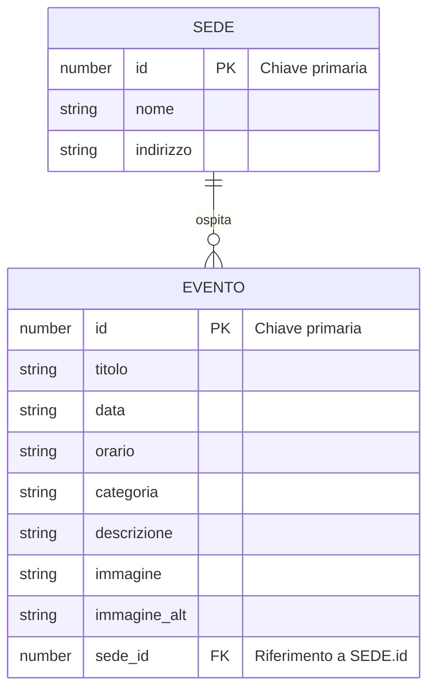

# Scheda Dati — Festival Segnale

Questo documento descrive la struttura, i campi e le relazioni dei dati archiviati nei file `dati/eventi.json` e `dati/sedi.json`.

---

## 1. Entità
Il modello dati del festival si basa su due entità principali:
* **Evento** (`dati/eventi.json`): rappresenta i singoli appuntamenti in programma (incontri, laboratori, mostre).
* **Sede** (`dati/sedi.json`): rappresenta gli spazi fisici in cui si svolgono le attività del festival.

---

## 2. Campi delle entità

### Entità `Evento` (`dati/eventi.json`)

| Campo | Tipo | Descrizione | Esempio |
| :--- | :--- | :--- | :--- |
| `id` | `number` | Identificativo univoco dell'evento | `1` |
| `titolo` | `string` | Titolo dell'appuntamento | `"Lettere in movimento"` |
| `data` | `string` | Data dell'evento in formato ISO (`YYYY-MM-DD`) | `"2026-06-12"` |
| `orario` | `string` | Orario di inizio in formato 24h (`HH:MM`) | `"10:00"` |
| `categoria` | `string` | Tipologia di attività (`Incontro`, `Laboratorio`, `Mostra`) | `"Incontro"` |
| `descrizione` | `string` | Breve testo descrittivo dell'evento | `"Come cambia un messaggio quando cambiano le lettere?..."` |
| `immagine` | `string` | Percorso relativo dell'illustrazione associata | `"assets/lettere-in-movimento.svg"` |
| `immagine_alt` | `string` | Testo alternativo per l'accessibilità dell'immagine | `"Lettere geometriche disposte su una griglia"` |
| `sede_id` | `number` | Riferimento all'identificativo della sede ospitante | `1` |

### Entità `Sede` (`dati/sedi.json`)

| Campo | Tipo | Descrizione | Esempio |
| :--- | :--- | :--- | :--- |
| `id` | `number` | Identificativo univoco della sede | `1` |
| `nome` | `string` | Denominazione dello spazio e del plesso | `"Officina Nord — Sede centrale"` |
| `indirizzo` | `string` | Via, numero civico e città della sede | `"Corso Duca degli Abruzzi 24, Torino"` |

---

## 3. Chiave primaria
* Per **`Evento`**: il campo `id` (intero positivo, univoco all'interno di `eventi.json` e stabile nel tempo, anche in caso di aggiunta o rimozione di record).
* Per **`Sede`**: il campo `id` (intero positivo, univoco all'interno di `sedi.json` e stabile).

---

## 4. Relazione
Tra **Sede** ed **Evento** intercorre una relazione **uno-a-molti (`1:N`)**:
* Una **Sede** può ospitare uno o più eventi.
* Ogni **Evento** si svolge in una sola sede.
* Il collegamento avviene tramite chiave esterna: il campo `Evento.sede_id` fa riferimento a `Sede.id`.

---

## 5. Quantità
Attualmente l'archivio contiene:
* **6 eventi** (distribuiti sulle due giornate del 12 e 13 giugno 2026).
* **3 sedi** (situate a Torino).

---

## 6. Manutenzione e aggiornamento
* **Chi aggiorna i dati:** il team editoriale e di sviluppo del progetto didattico.
* **Come avviene l'aggiornamento:** tramite modifica diretta dei file JSON (`dati/eventi.json` e `dati/sedi.json`) all'interno della repository Git, seguita dal commit e dalla pubblicazione automatica del sito statico.

---

## 7. Che cosa mostra la pagina
I dati vengono letti dinamicamente per popolare le interfacce del sito:
* Nella pagina **Programma** (`programma.html`), vengono elencati tutti gli eventi con data, orario, categoria, titolo, descrizione, immagine e — risolvendo il collegamento `sede_id` — il nome e l'indirizzo della sede corrispondente.
* Nella pagina **Info e luoghi** (`info.html`), vengono presentate le tre sedi con i relativi indirizzi, indicazioni stradali e collegamenti sulla mappa.

---

## Schema relazionale (Mermaid)

